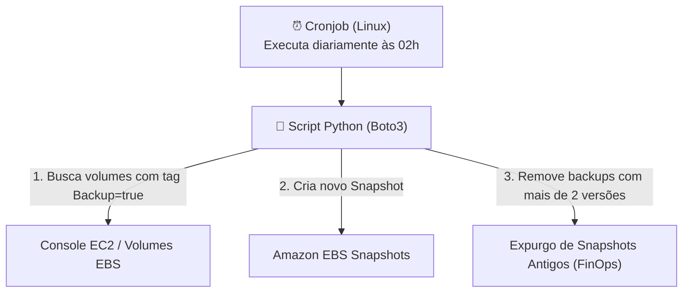

# Lab AWS - Automacao de Backup de Volumes EBS com Python e Boto3

Prática desenvolvida durante a formação **AWS re/Start (Escola da Nuvem)** para demonstrar como automatizar a rotina de cópias de segurança (snapshots) de discos EBS e evitar custos desnecessários com armazenamento mantendo uma política de retenção.

A maior parte dos recursos foi configurada pelo **Console da AWS**, utilizando um script simples em **Python com a biblioteca Boto3** agendado no Linux via **Cronjob**.

---

## 🏛️ Como a Solução Funciona

1. As instâncias que precisam de backup recebem a tag `Backup = true` no Console da AWS.
2. O script Python roda automaticamente toda noite pelo Cronjob do Linux.
3. O script busca todos os volumes com a tag, tira o snapshot e apaga os snapshots antigos, mantendo apenas os **2 mais recentes**.



---

## 🛠️ Passo a Passo da Configuração

### 1. Marcar os Volumes com Tag no Console (Console EC2)
1. Acesse **EC2** > **Volumes**.
2. Selecione o volume que deseja incluir no backup.
3. Vá na aba **Tags** e adicione:
   - Chave: `Backup`
   - Valor: `true`

### 2. Configurar a Permissão IAM (Console IAM)
A instância EC2 onde o script roda precisa de permissão para ler volumes e gerenciar snapshots:
1. No console **IAM**, crie uma função (Role) para EC2 com permissões mínimas:
   - `ec2:DescribeVolumes`
   - `ec2:DescribeSnapshots`
   - `ec2:CreateSnapshot`
   - `ec2:CreateTags`
   - `ec2:DeleteSnapshot`
2. No console EC2, anexe a Role na instância (**Ações > Segurança > Modificar perfil do IAM**).

### 3. Executar e Testar o Script na EC2 (Terminal Linux)
Conecte na sua instância EC2 via terminal e instale a biblioteca da AWS para Python:

```bash
# 1. Instalar o Boto3
pip3 install boto3

# 2. Executar o script manualmente para testar
python3 backup_ebs.py
```

Saída esperada no terminal:
```text
Iniciando rotina de backup dos volumes EBS...
Processando volume: vol-0abc123456789def0
Snapshot criado com sucesso: snap-0123456789abcdef0
Rotina de backup finalizada com sucesso!
```

---

### 4. Agendar a Execução Automática com Cronjob
Para que o backup rode todos os dias automaticamente às 02h da manhã:

```bash
# Abra o editor do agendador Cron
crontab -e
```

Adicione a linha:
```text
0 2 * * * /usr/bin/python3 /home/ec2-user/backup_ebs.py >> /var/log/backup_ebs.log 2>&1
```

---

## 💰 Benefício FinOps
Sem uma rotina de expurgo, snapshots antigos continuam sendo cobrados mês a mês no faturamento da AWS ($0,05 por GB/mês). Ao manter uma retenção fixa das últimas 2 cópias, o custo de armazenamento permanece previsível e controlado.

---

## 🧹 Limpeza de Recursos (Teardown)
1. No console EC2 > **Snapshots**, selecione os snapshots gerados pelo teste e clique em **Ações > Excluir snapshot**.
2. Finalizar a instância EC2 de testes.
