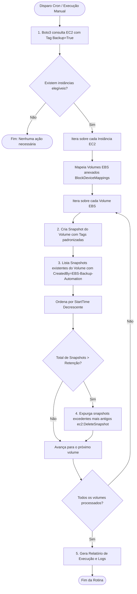

# 🛡️ AWS Lab: Automação de Backup e Retenção de Volumes EBS com Boto3

[](https://aws.amazon.com/ebs/)
[](https://www.python.org/)
[](https://boto3.amazonaws.com/v1/documentation/api/latest/index.html)
[](https://www.finops.org/)
[](LICENSE)

Este repositório apresenta uma solução completa de engenharia para automação de rotinas de backup de volumes **Amazon EBS** utilizando **Python 3** e a biblioteca oficial **Boto3**, agendada via **Cron**. A solução implementa governança através de tags, tratamento de exceções, modo de simulação (*dry-run*) e uma política automática de retenção que expurga snapshots antigos para contenção de custos (FinOps).

---

## 📑 Sumário

- [Visão Geral & Fluxo de Execução](#-visão-geral--fluxo-de-execução)
- [Estrutura do Repositório](#-estrutura-do-repositório)
- [Matriz de Permissões IAM (Menor Privilégio)](#-matriz-de-permissões-iam-menor-privilégio)
- [Instalação e Configuração](#-instalação-e-configuração)
- [Guia de Utilização](#-guia-de-utilização)
  - [1. Simulação com Modo Dry-Run](#1-simulação-com-modo-dry-run)
  - [2. Execução Real em Produção](#2-execução-real-em-produção)
  - [3. Customização de Tags e Retenção](#3-customização-de-tags-e-retenção)
- [Agendamento com Cron](#-agendamento-com-cron)
- [Decisões de Arquitetura (ADR)](#-decisões-de-arquitetura-adr)
- [Estimativa e Otimização de Custos (FinOps)](#-estimativa-e-otimização-de-custos-finops)
- [Teardown & Limpeza](#-teardown--limpeza)

---

## 🔄 Visão Geral & Fluxo de Execução

O script descobre instâncias com base em tags de governança (ex: `Backup=True`), enumera todos os volumes EBS anexados, dispara a criação de snapshots consistentes e remove snapshots legados gerados pela própria automação que ultrapassarem o limite configurado (padrão: 2 snapshots mais recentes).



---

## 📂 Estrutura do Repositório

```text
aws-lab-ebs-backup-boto3/
├── README.md                  # Documentação técnica e guia operacional
├── .gitignore                 # Arquivos ignorados (venv, caches, logs)
├── requirements.txt           # Dependências do projeto (boto3, botocore)
├── backup_ebs.py              # Script principal de automação e expurgo
├── cron/
│   └── crontab.example        # Modelos de agendamento no cron do Linux
└── iam/
    └── ebs-backup-policy.json # Política de menor privilégio para IAM Role
```

---

## 🛡 Matriz de Permissões IAM (Menor Privilégio)

O arquivo [`iam/ebs-backup-policy.json`](iam/ebs-backup-policy.json) define os privilégios estritos necessários para a execução do script:

| Ação IAM | Recursos | Condição de Segurança |
| :--- | :--- | :--- |
| `ec2:DescribeInstances`<br>`ec2:DescribeVolumes`<br>`ec2:DescribeSnapshots`<br>`ec2:DescribeTags` | `*` | Operações de leitura para descoberta de recursos |
| `ec2:CreateSnapshot` | `volume/*`, `snapshot/*` | Permite criação apenas sobre volumes existentes |
| `ec2:CreateTags` | `snapshot/*` | Restrito à ação `ec2:CreateAction=CreateSnapshot` |
| `ec2:DeleteSnapshot` | `snapshot/*` | **Condição:** Exclui **apenas** snapshots que possuam a tag `CreatedBy=EBS-Backup-Automation`, impedindo exclusão acidental de snapshots manuais ou de outras ferramentas |

---

## 💻 Instalação e Configuração

### 1. Clonar o repositório e preparar ambiente virtual

```bash
git clone https://github.com/CesarLana/aws-lab-ebs-backup-boto3.git
cd aws-lab-ebs-backup-boto3

# Criação de ambiente virtual isolado
python3 -m venv venv
source venv/bin/activate

# Instalação das dependências
pip install -r requirements.txt
```

### 2. Autenticação na AWS

Se executado em uma instância EC2, anexe uma **IAM Role** com a política contida em `iam/ebs-backup-policy.json`.  
Se executado localmente para testes:

```bash
export AWS_ACCESS_KEY_ID="sua-access-key"
export AWS_SECRET_ACCESS_KEY="sua-secret-key"
export AWS_DEFAULT_REGION="us-east-1"
```

---

## 📖 Guia de Utilização

### 1. Simulação com Modo Dry-Run

O modo `--dry-run` permite inspecionar quais instâncias seriam localizadas, quais snapshots seriam gerados e quais seriam expurgados, sem aplicar nenhuma mutação na AWS:

```bash
python3 backup_ebs.py --dry-run --verbose
```

### 2. Execução Real em Produção

```bash
python3 backup_ebs.py \
  --tag-key "Backup" \
  --tag-value "True" \
  --retention 2 \
  --log-file "/var/log/ebs-backup.log"
```

### 3. Customização de Tags e Retenção

Para realizar backup de instâncias de bancos de dados com retenção de 5 snapshots:

```bash
python3 backup_ebs.py \
  --tag-key "Environment" \
  --tag-value "Database-Production" \
  --retention 5 \
  --region "sa-east-1"
```

**Exemplo de saída de log:**
```text
[INFO] 2026-11-06 02:00:01 - ==========================================================
[INFO] 2026-11-06 02:00:01 - Iniciando rotina de automação de backup EBS
[INFO] 2026-11-06 02:00:01 - Região AWS       : us-east-1
[INFO] 2026-11-06 02:00:01 - Filtro de Tag    : Backup=True
[INFO] 2026-11-06 02:00:01 - Limite Retenção  : 2 snapshots
[INFO] 2026-11-06 02:00:01 - Modo Dry-Run     : False
[INFO] 2026-11-06 02:00:01 - ==========================================================
[INFO] 2026-11-06 02:00:02 - Total de instâncias elegíveis encontradas: 2
[INFO] 2026-11-06 02:00:02 - Processando Instância: i-0abc1234def567890 (Total de volumes anexados: 1)
[INFO] 2026-11-06 02:00:03 - Snapshot criado com sucesso: snap-0123456789abcdef0
[INFO] 2026-11-06 02:00:04 - Volume vol-0987654321fedcba0 possui 3 snapshots gerenciados pela automação.
[INFO] 2026-11-06 02:00:04 - Excluindo snapshot antigo: snap-0a1b2c3d4e5f6g7h8 (2026-11-04T02:00:00+00:00)...
[INFO] 2026-11-06 02:00:05 - Snapshot snap-0a1b2c3d4e5f6g7h8 excluído com sucesso.
[INFO] 2026-11-06 02:00:05 - ==========================================================
[INFO] 2026-11-06 02:00:05 - Resumo da Execução:
[INFO] 2026-11-06 02:00:05 - Snapshots criados   : 2
[INFO] 2026-11-06 02:00:05 - Snapshots expurgados: 2
[INFO] 2026-11-06 02:00:05 - Rotina finalizada com sucesso!
[INFO] 2026-11-06 02:00:05 - ==========================================================
```

---

## ⏰ Agendamento com Cron

Configure o agendamento no sistema Linux para execução recorrente:

```bash
# Editar crontab
crontab -e
```

Insira a linha recomendada (execução diária às 02:00 AM):

```cron
0 2 * * * /opt/ebs-backup/venv/bin/python /opt/ebs-backup/backup_ebs.py --tag-key Backup --tag-value True --retention 2 >> /var/log/ebs-backup.log 2>&1
```

---

## 💡 Decisões de Arquitetura (ADR)

| Decisão | Alternativa Rejeitada | Racional Técnico |
| :--- | :--- | :--- |
| **Identificação via Tags** | Mapeamento estático de IDs de volume | Desacoplamento operacional. Novos servidores e volumes que necessitam de backup são incluídos automaticamente sem alteração de código ou arquivos de configuração. |
| **Expurgo Baseado em Retenção por Volume** | Exclusão por idade fixa (ex: > 7 dias) | Garante que se uma instância parar de rodar ou o cron falhar, os backups mínimos necessários não serão deletados acidentalmente por tempo decorrido. |
| **Tag Condition no IAM DeleteSnapshot** | Permissão `ec2:DeleteSnapshot` irrestrita | Impede que a automação delete snapshots manuais criados por operadores ou snapshots de golden images de AMIs. |
| **Boto3 Paginated Queries** | Consultas diretas sem paginação | Permite escalar o script para contas corporativas com centenas ou milhares de instâncias sem estouro de limites ou memory leaks. |

---

## 💰 Estimativa e Otimização de Custos (FinOps)

O armazenamento de snapshots EBS é cobrado proporcionalmente aos dados alterados (*delta* incremental):
- **Custo de Armazenamento EBS Snapshot (Standard - us-east-1):** \$0.05 por GB/mês.

### Cenário Comparativo (Volume de 100 GB com 5 GB de alteração diária):

| Cenário | Quantidade de Snapshots (30 dias) | Volume Armazenado Médio | Custo Mensal Estimado |
| :--- | :--- | :--- | :--- |
| **Sem Política de Retenção (Acúmulo infinito)** | 30 snapshots | ~245 GB acumulados | **\$12.25 / mês por volume** |
| **Com Retenção Ativa (`--retention 2`)** | 2 snapshots | ~105 GB | **\$5.25 / mês por volume** |
| **Economia Direta** | - | - | **57% de redução de custos mensais** |

> Em ambientes com 50 instâncias, a economia gerada por esta automação supera **\$350.00 / mês** em custos de snapshots órfãos.

---

## 🧹 Teardown & Limpeza

Para remover os recursos e testes criados durante o laboratório:

```bash
# 1. Remover snapshots criados pela automação
aws ec2 describe-snapshots \
  --owner-ids self \
  --filters "Name=tag:CreatedBy,Values=EBS-Backup-Automation" \
  --query "Snapshots[*].SnapshotId" \
  --output text | xargs -n 1 -r aws ec2 delete-snapshot --snapshot-id

# 2. Deletar a política IAM anexada à role
aws iam delete-policy --policy-arn "arn:aws:iam::<ACCOUNT_ID>:policy/EBSBackupAutomationPolicy"
```

---

## 👨‍💻 Autor

Desenvolvido por **Cesar Lana**  
GitHub: [@CesarLana](https://github.com/CesarLana)
